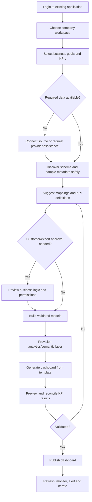
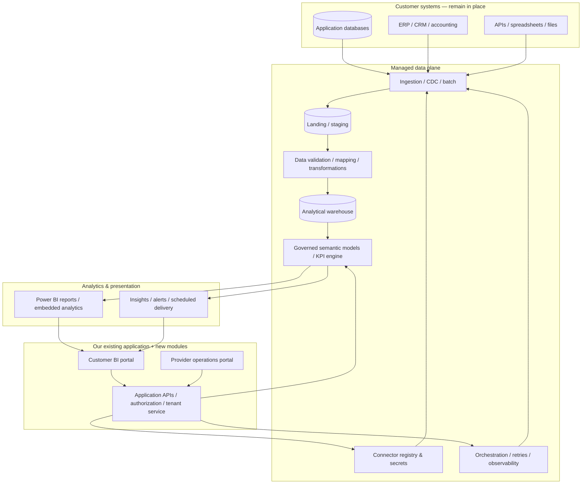

# Business Intelligence Platform — Product Requirements Document (PRD)

**Status:** Product concept / requirements baseline  
**Version:** 1.0  
**Audience:** Product management, engineering, data engineering, BI specialists, design, operations  
**Product type:** Multi-tenant Business Intelligence and Analytics Platform  
**Important context:** **We already have an existing application.** This document defines capabilities to **extend and integrate with that application**, not an assumption that the whole product must be rebuilt. Existing architecture, users, authorization, technologies, and integrations must be audited before implementation.

---

## 1. Executive Summary

We are building a platform that lets companies monitor operational and financial performance, gain insights, and make decisions using trustworthy data. The product combines a **customer self-service portal** with a **provider (our company) operations portal**.

The defining customer experience is:

1. A customer logs in to their company workspace in the **existing application**.
2. They choose business goals and **KPIs** (e.g., revenue, expenses, gross margin, completed orders, customer retention).
3. The platform determines which data and approved definitions each KPI needs, checks whether the company's connected sources support it, and guides the customer through any missing configuration or approvals.
4. It builds or reuses validated data pipelines, transformations, warehouse models, and a **semantic model**.
5. It generates a configurable dashboard/report with charts, filters, time ranges, drill-downs, access controls, and refresh settings.
6. The customer reviews the results, publishes the dashboard, and monitors it over time.

Our company administers the underlying infrastructure, integrations, data modeling, warehouse optimization, quality, security, and support in a separate **provider operations portal**.

**Product principle:** Automate repetitive setup and analytics work while requiring explicit review when a business definition, data relationship, security decision, or financially important number is uncertain.

## 2. Product Vision and Goals

### Vision

> Any authorized company user can move from a business question or chosen KPI to a trustworthy, customizable dashboard, without needing to manually build a full data engineering stack.

### Goals

- Make BI accessible to customers through a guided self-service experience.
- Reuse a common platform across multiple companies while maintaining strict tenant separation.
- Integrate with customers' **existing systems and applications** rather than requiring replacement.
- Automate data connection, ingestion, transformation, validation, model provisioning, and report generation where safe.
- Provide an expert operational environment for our internal analysts, data engineers, and platform operators.
- Support historical analytics first, with optional near-real-time and streaming use cases later.
- Keep metrics explainable, auditable, and reconciled with customer systems.

### Non-goals for the first release

- Building a fully custom visualization engine comparable to every feature of Power BI.
- Fully autonomous approval of accounting rules, sensitive KPI definitions, or high-risk access policies.
- Supporting every database, industry, and streaming scenario on day one.
- Replacing the customer's source ERP, CRM, transactional database, or accounting system.
- Automatically making consequential business decisions for customers.

## 3. Product Boundaries and Existing Application

**Existing application is an explicit constraint.** We need a discovery phase to determine what can be reused:

- Current frontend, backend, authentication, user and organization models.
- Existing customer workflows, routes, navigation, permissions, and design system.
- Existing data sources, APIs, database schemas, infrastructure, deployments, and analytics features.
- Whether the existing application already handles single-tenant/multi-tenant access.

**Default integration strategy:** extend the existing application with customer BI modules and add a role-restricted provider workspace. Keep a separate data plane (connectors, ingestion, warehouse, analytical query services) where appropriate. Do not migrate or replace existing workflows without evidence that it is required.

The exact stack and current codebase capabilities are **TBD**, not assumed by this PRD.

## 4. Personas and Access Model

| Persona | Objective | Typical permissions |
|---|---|---|
| Customer organization owner | Set up company reporting | Manage workspace, source approvals, subscriptions, reporting policies |
| Customer admin / BI manager | Configure analytics | Select KPIs, validate rules, manage dashboards and users |
| Customer analyst | Explore data | Create and edit authorized reports, filters, and measures within policy |
| Customer viewer / executive | Monitor performance | View permitted dashboards, schedule reports and alerts |
| Provider platform admin | Operate the service | Manage tenants, provisioning, quotas, platform policies and incidents |
| Provider data engineer | Maintain data movement | Configure connectors, CDC, orchestration, transformations, mappings |
| Provider BI / business analyst | Validate semantics | Review KPI definitions, reconciliations, semantic models, dashboards |
| Provider data platform engineer | Optimize analytical storage | Monitor warehouse health, query costs, indexes/partitions, performance |
| Support / auditor | Resolve issues safely | Time-limited audited support access / read-only audit trails |

**Security default:** provider employees do not automatically receive unrestricted access to client data. Use least privilege, scoped support access, tenant isolation, and auditable access grants.

## 5. Core Product Experience — Customer Portal

### 5.1 Customer journey



### 5.2 Customer modules

#### A. Company workspace and onboarding

- Company profile, industry, timezone, business calendar, reporting currency.
- Guided onboarding questionnaire for business operations and reporting goals.
- Data connection readiness checklist and source ownership/consent.
- Optional managed onboarding with our provider team.

#### B. KPI catalog and selection — the primary entry point

Customers select KPIs **before** a dashboard is generated. Examples:

- **Finance:** revenue, recognized revenue, gross profit, gross margin, operating expenses, net profit (if supporting accounting data exists), cash collected.
- **Sales:** orders, average order value, sales growth, product/category performance, conversion rate (if event data exists).
- **Customers:** new customers, active customers, retention, churn, customer lifetime value (if model and history permit).
- **Operations:** fulfillment time, delivery performance, backlog, cancellations, inventory movement.

Each KPI card must show:

- Business definition and formula; unit/currency/time grain.
- Required sources, fields, joins, and minimum historical coverage.
- Eligibility state: **Ready**, **Needs mapping**, **Needs source**, **Needs definition approval**, or **Unsupported**.
- Source freshness and last successful validation.
- Known exclusions, assumptions, and data-quality warnings.

**Critical rule:** selecting a KPI is a *request to configure and validate it*, not permission to invent missing fields or assume accounting definitions.

#### C. Data connections (customer-facing)

- Read-only connection setup or secure credential delegation.
- Supported databases, APIs, and file imports for MVP; add more connectors by demand.
- Connection tests, scope selection, synchronization schedule, consent/approval.
- Clear connection health and ingest status; no raw secrets displayed after saving.

#### D. Dashboard generation and customization

After KPI validation, the system generates a **draft dashboard**:

- Suggested report pages and visuals appropriate to each metric.
- Date range, granularity, dimensions, filters and slicers.
- Drill-down and cross-filtering; where supported, drill-through.
- Comparison periods, target/actual and variance views.
- Layout, titles, theme, branding, rearrangement, and saved views.
- Data refresh/freshness label and relevant warnings.
- Role-based sharing and export/scheduling options consistent with policy.
- Edit, preview, publish, unpublish, version and duplicate actions.

**Visualization strategy decision:** build on Power BI's semantic models/reports/embedding where it fits the customer's deployment, license, governance, and customization needs. A future native charting layer is an alternative—not an implied Power BI feature clone. Actual available controls vary by integration mode and should be verified in a technical spike.

#### E. Insights and alerts

- Scheduled KPI digests, threshold-based alerts, and anomaly candidates.
- Trend and variance descriptions with evidence links to contributing measures.
- Clearly distinguish observed changes from hypothetical causal explanations.
- Customers can configure thresholds, delivery channels, recipients, and quiet hours.

#### F. Governance and billing

- Users, groups, roles, row-level entitlements, audit log.
- Data retention and export controls; subscription/usage/quotas if commercialized.
- Support tickets, data-quality issue reports, and SLA status.

## 6. Provider Operations Portal — Our Company

This is a distinct, privileged workspace for managing the **data platform** behind customer BI.

| Module | Required capabilities |
|---|---|
| Tenant administration | Provision/deactivate companies, enforce isolation, quotas, environments, service plans |
| Data-source registry | Inventory connectors, credentials vault references, network/access policies, test connections |
| Data discovery & profiling | Inspect schemas, infer candidate relationships, classify sensitive fields, detect drift |
| Ingestion management | Full/incremental loads, CDC where appropriate, schedules, checkpoints, retries, backfills, dead-letter handling |
| Mapping and transformation studio | Map source fields to canonical entities; review transformation rules; version pipelines |
| Data quality | Completeness, uniqueness, freshness, referential integrity, rule validation, reconciliations |
| Warehouse management | Logical schemas, tenant separation, storage lifecycle, partitioning/indexing where supported, query plans, tuning |
| Semantic/KPI model management | Governed KPI registry, measures, dimensions, relationships, calculation rules, versioning |
| Dashboard template management | Industry templates, supported visual definitions, theme and layout presets, publishing rules |
| Orchestration and observability | Pipeline graph, job status, latency, costs, health, alerts, incident resolution |
| Security and audit | RBAC/ABAC, support access requests, secrets handling, encryption, audit trails |
| Customer support workflows | Onboarding approvals, mapping/definition review, ticket escalation, change approvals |

### Provider controls must distinguish

- **Global platform configuration** vs. **one tenant's configuration**.
- **Infrastructure settings** vs. **business definitions**.
- **Proposed AI changes** vs. **approved, deployed changes**.
- **Operational telemetry** vs. **customer financial/business data**.

## 7. End-to-End Technical Architecture



**Architecture interpretation:**

- **Control plane:** customer and provider workflows, approvals, tenants, metadata, policies, configuration, provisioning.
- **Data plane:** customer data ingestion, staging, transformation, warehouse/query processing.
- **Presentation plane:** Power BI-based reporting or another approved BI renderer plus insights and notifications.
- **Metadata plane:** source catalogs, business definitions, lineage, model versions, quality checks and dashboard configurations.

### Data connectivity and refresh modes

| Mode | Use case | Consideration |
|---|---|---|
| Scheduled batch + import | Daily/weekly financial and management reports | Best first-release default; latency follows schedule |
| Incremental / CDC | More frequent changes to operational tables | Requires source capability, recoverability, schema drift strategy |
| Power BI DirectQuery | Query supported analytical sources at report interaction time | Warehouse performance, concurrency, latency and supported connector limits matter |
| Near-real-time analytics | Fresh operational KPIs | Streaming/event ingestion and serving layer may be needed |
| Push/event-based scenarios | Alerts and event-driven experiences | Do not assume legacy Power BI streaming features fit all new designs; evaluate current supported approach |

A single platform can support several refresh strategies; each KPI/dashboard should expose its **freshness contract** and mode. Do not change warehouse technology based solely on a desire for a constantly changing chart.

### Tenant isolation strategy

Decide using security, scale and customer requirements:

- Shared warehouse with strong per-tenant isolation and access controls;
- Separate schema/database per tenant;
- Dedicated tenant deployment for high-sensitivity/regulated clients.

Whichever is chosen, enforce tenant context **server-side throughout ingestion, storage, semantics, query serving and reporting**. UI-only filtering is not sufficient.

### Deployment strategy

Support deployment profiles only when justified:

- **Provider-managed cloud:** preferred initial operational model, if client data policy permits.
- **Customer private cloud/VPC:** for customer network/security requirements.
- **On-premises or hybrid:** future enterprise profile with constrained networking and higher operations burden.

The precise warehouse and orchestration technologies are **architecture decisions**, not fixed product commitments at this stage.

## 8. KPI-to-Dashboard Generation Engine

This is the core differentiator.

### Inputs

- Selected KPI IDs and business goals.
- Tenant-approved data-source metadata and field mappings.
- Approved metric definitions, measures, dimensions, grain, and business calendars.
- Data availability, quality, permissions and freshness requirements.
- Industry template and preferred dashboard configuration.

### Processing stages

1. **Resolve requirements:** identify required entities, joins, time fields, formulas and filters for each KPI.
2. **Perform readiness check:** identify missing sources, fields, historical depth or approvals.
3. **Generate proposals:** candidate mappings, transformations, semantic objects and visuals.
4. **Approval gate:** business owner/BI expert signs off on ambiguous definitions and sensitive models.
5. **Provision pipelines:** create or reuse extraction, transformation and scheduling configurations.
6. **Build semantic model:** generate governed measures, relationships and security context.
7. **Create report:** instantiate a versioned dashboard template and bind validated measures.
8. **Reconcile:** compare totals with agreed source reports, sample edge cases and validate access.
9. **Publish:** activate scheduled refresh and operational monitoring.
10. **Maintain:** detect drift, source failures, KPI changes, and propose controlled updates.

### Example KPI specification

```yaml
kpi_id: completed_sales_revenue
name: Completed Sales Revenue
status: needs_business_approval
unit: currency
required_entities:
  - orders
  - payments
required_fields:
  - orders.order_id
  - orders.status
  - payments.amount
  - payments.payment_status
  - payments.paid_at
business_questions:
  - Which payment statuses qualify as collected sales?
  - How are refunds, taxes, discounts and multiple payments handled?
  - Which reporting currency and timezone apply?
approval_owner_role: customer_bi_admin
suggested_visuals:
  - metric_card
  - time_series
  - breakdown_by_category
```

This definition is intentionally **not executable financial logic** until customer-specific answers are approved.

### Dashboard lifecycle states

`Draft → Needs configuration → Awaiting approval → Validating → Ready to publish → Published → Degraded / Needs attention → Archived`

Each transition must have an owner, auditable reason and retry/failure behavior.

## 9. Automation Policy

| Capability | Target automation | Required human involvement |
|---|---|---|
| Connector setup and test | High | Approve access and scopes |
| Schema discovery / metadata inventory | High | Review sensitive field classification |
| Ingestion scheduling / retries / CDC | High | Resolve exceptional source failures |
| Cleaning / normalization | High for approved rules | Approve newly inferred business rules |
| Warehouse optimization recommendations | Medium–high | Review cost/performance-impacting production changes |
| KPI definition and joins | AI-assisted / partial | Customer business owner or BI analyst approves |
| Dashboard template creation | High once data is validated | User adjusts presentation; owner signs off |
| Quality monitoring and alerts | High | Triage serious incidents |
| Trend summaries / anomaly detection | High | Verify causal interpretations and financial claims |
| Final strategy and consequential decisions | Human-led | Decision owners remain accountable |

**AI design rules:** all AI-generated code, SQL, DAX, mappings, KPI formulas and suggested explanations are drafts; execute only after automated checks and, for sensitive changes, explicit approval. Include provenance, confidence/uncertainty, rollback, lineage and audit history.

## 10. Functional Requirements and Acceptance Criteria

| ID | Requirement | Acceptance condition |
|---|---|---|
| FR-01 | Existing-app login integration | Authorized users reach the correct tenant workspace without a duplicate identity flow unless required |
| FR-02 | Customer KPI selector | User selects supported KPIs, sees prerequisites and readiness status |
| FR-03 | Secure source onboarding | Authorized admin can connect/test sources with encrypted secrets and scoped access |
| FR-04 | Data discovery | Source schemas and metadata are viewable with tenant permissions |
| FR-05 | KPI validation | Unresolved definitions or missing data block publication of affected metrics |
| FR-06 | Pipeline provisioning | Approved KPI dependencies trigger reusable jobs with status, retries and failure logging |
| FR-07 | Warehouse/semantic model | Validated data is queryable through governed metric definitions |
| FR-08 | Automated draft dashboard | A compatible template generates charts with functioning KPI bindings and filters |
| FR-09 | Dashboard configuration | User can customize supported time ranges, dimensions, layout, and sharing |
| FR-10 | Refresh visibility | Dashboard displays last-successful data refresh and errors/degraded state |
| FR-11 | Tenant security | Cross-tenant records cannot be accessed via UI, APIs, exports, analytics queries or report embeds |
| FR-12 | Provider operations | Authorized provider staff can administer sources, ingestion, models, quality, and warehouse tuning |
| FR-13 | Traceability | A displayed KPI can be traced to its definition, source, transformations and validation version |
| FR-14 | Auditability | Changes to connections, definitions, permissions and published dashboards are recorded |
| FR-15 | Recovery | Failed pipelines can be retried/backfilled without silent duplication |

## 11. Key Product Screens

### Customer portal

1. **Overview / Home:** current dashboards, recommended next steps, reporting health.
2. **Choose KPIs:** searchable catalog, business category, readiness and dependencies.
3. **Connect data:** connector wizard, permissions and test status.
4. **Resolve missing configuration:** map fields, define accounting rules, approve metrics.
5. **Generate dashboard:** select template, review proposed visualizations, preview measures.
6. **Dashboard editor:** supported filters, layout, labels, visual settings, sharing, refresh preferences.
7. **Dashboard viewer:** drill-downs, comparisons, freshness, alerts and reports.
8. **Workspace settings:** teams, roles, security, billing and audit.

### Provider portal

1. **Tenant overview:** onboarding stage, health, SLA and consumption.
2. **Source registry:** connectors, credentials references, metadata, schema-drift events.
3. **Ingestion console:** sync jobs, change streams, errors, retry/backfill.
4. **Mapping studio:** canonical mappings, transformation proposals, validation previews.
5. **Warehouse console:** schemas, data volume, costly queries, optimization suggestions.
6. **Semantic/KPI registry:** governed measures, dimensions, versions and approvals.
7. **Template library:** configurable dashboard templates and industry packs.
8. **Observability & support:** incidents, lineage, audit logs and access grants.

## 12. Illustrative User Stories

- **As a customer executive**, I select Revenue, Expenses and Profit and receive a dashboard with valid financial definitions so I can see company performance without writing queries.
- **As a customer admin**, I see why a KPI cannot yet be calculated and can supply the missing information or request support.
- **As a customer analyst**, I edit dashboard filters and visual layout without altering approved metric formulas.
- **As a provider data engineer**, I connect an existing ERP database and configure safe incremental synchronization, retries and schema-change detection.
- **As a provider BI analyst**, I review the definition of Net Profit, approve the financial treatment and reconcile it with customer source statements.
- **As a platform administrator**, I diagnose slow reports and optimize warehouse workload without exposing one company's data to another.

## 13. MVP and Phased Roadmap

### Phase 0 — Existing-product audit and product discovery

- Inventory existing application, auth, API, data stores, roles, deployments and user workflows.
- Interview prospective customers and internal experts.
- Select **one pilot company** and **one KPI domain** (e.g., sales, rather than all of finance).
- Agree ownership for metric definitions and data access.
- Prototype Power BI embedding/provisioning and licensing constraints.

**Exit criterion:** approved integration design, pilot data access, KPI dictionary and baseline security model.

### Phase 1 — Foundational data platform (MVP)

- Tenant/workspace integration with existing application.
- Provider source registry and 1–2 high-demand connectors.
- Scheduled batch ingestion, staging, data-quality checks and warehouse model.
- Approved KPI catalog for pilot domain; source-to-metric lineage.
- Provider jobs/health dashboard.

**Exit criterion:** pilot customer receives accurate, refreshable KPI data with reconciliation evidence.

### Phase 2 — Self-service dashboards (MVP customer experience)

- Customer KPI selection, readiness checks and configuration wizard.
- Reusable metric/semantic model and dashboard templates.
- Automated draft generation, editing, preview, validation and publication.
- Workspace permissions and operational health indicators.

**Exit criterion:** customer selects approved KPIs and publishes a working dashboard with minimal provider intervention.

### Phase 3 — Scale and intelligent assistance

- Additional connectors and industries; reusable mapping templates.
- CDC/incremental refresh where justified, backfills and schema-drift automation.
- AI-assisted KPI mapping, DAX/SQL drafting and explanatory insights.
- Alerts, anomaly detection, cost optimization, and self-service diagnostics.

**Exit criterion:** repeated onboarding and maintenance work measurably decreases without reducing trust or isolation.

### Phase 4 — Enterprise options

- Hybrid/private deployments; fine-grained governance and advanced SSO.
- Near-real-time analytics and optional alternative serving engines.
- Enhanced warehouse performance features and multi-region controls.

## 14. Success Metrics

Define baselines during pilots; proposed metrics include:

| Metric | What it measures |
|---|---|
| Time to first trusted dashboard | Onboarding start until validated published report |
| KPI activation rate | Selected KPIs that pass readiness and validation |
| Self-service completion rate | Dashboards published without provider manual build |
| Reconciliation success rate | Financial/operational measures matching approved control totals |
| Freshness SLA attainment | Dashboards meeting their agreed refresh contracts |
| Pipeline recovery rate | Failed sync jobs restored within SLA |
| Cross-tenant security incidents | Target: zero |
| Cost per active tenant/dashboard | Infrastructure and support efficiency |
| Active dashboard usage | Adoption and business utility |
| Expert effort per onboarding | Degree of safe automation |

Avoid treating dashboard count alone as evidence of customer value.

## 15. Risks, Constraints, and Decisions

### Key risks

- **Incorrect KPIs:** revenue, profit and retention may have different meanings in each business.
- **Misleading auto-discovery:** similar table/column names can represent different concepts.
- **Weak source data:** inconsistent IDs, historical gaps, partial refunds, late events.
- **Cross-tenant leaks:** dashboards, row-level access, exports or embedded reports may bypass application expectations if poorly configured.
- **Power BI constraints:** embedding, automation APIs, licensing/capacity, feature support and identity mapping must be confirmed for the chosen delivery model.
- **Operational complexity:** CDC, streaming and on-prem deployments raise maintenance costs.
- **Warehouse performance/cost:** uncontrolled DirectQuery, concurrency or transformations can become expensive.
- **AI overconfidence:** generated formulas/explanations require verification.

### Open decisions

1. What exact existing application, identity provider and tenant model are we extending?
2. Is the first customer an external organization or an internal company/division?
3. Which **pilot industry** and first 5–10 KPIs should we support?
4. Which customer systems and source database technologies are already in use?
5. Will customers view **embedded Power BI reports**, access Power BI directly, or use a mixed experience?
6. What deployment and data-residency requirements apply?
7. What is the minimum accepted data freshness: daily, hourly, or near-real-time?
8. Who signs off on KPI definitions, semantic models and reconciliations?
9. Which dashboards should be editable by customers vs. constrained to approved templates?
10. Is the product commercialized as self-service SaaS, managed BI, enterprise projects, or a hybrid?

## 16. Recommended Product Positioning

**Positioning statement:**

> A business intelligence automation platform that connects to a company's existing systems, lets teams select the KPIs they care about, and transforms approved data and business rules into configurable, trustworthy dashboards—while giving our provider team professional tools for integration, data modeling, warehouse management, quality and operations.

**Our differentiator is not simply showing charts.** It is the repeatable **KPI selection → data readiness → trusted semantic model → automated dashboard → continuous monitoring** lifecycle, delivered on top of the customers' existing applications and data sources.

---

### Appendix A — Glossary

- **KPI:** a defined business performance measure.
- **Data ingestion:** bringing data from source systems into the analytics platform.
- **CDC (Change Data Capture):** collecting changes made to a source system.
- **Data warehouse:** an analytical store optimized for reporting/analysis workloads.
- **Semantic model:** business-friendly layer defining metrics, measures, dimensions, relationships and security.
- **DAX:** formula language for analytical measures in Microsoft Power BI semantic models.
- **DirectQuery:** a Power BI storage/query mode where report interactions can query supported underlying sources.
- **Tenant:** a customer organization with isolated data, settings and users.
- **Data lineage:** record of how reported data originated and was transformed.
- **Reconciliation:** checking analytical results against agreed control totals/source records.
